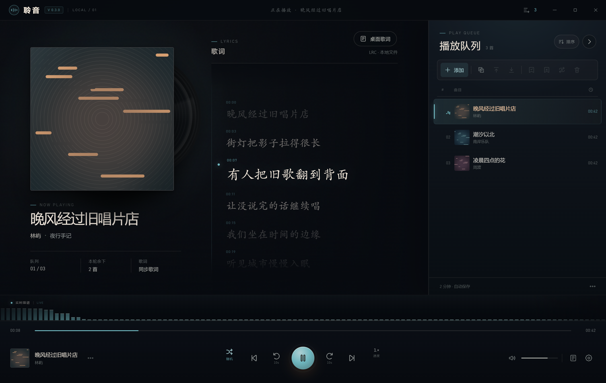
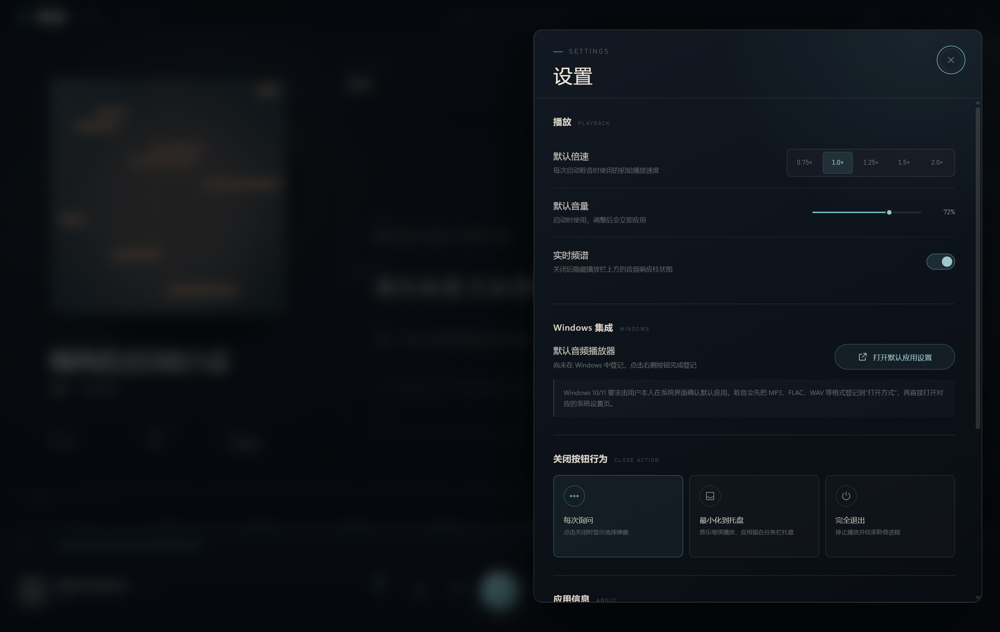

# 聆音 Lingyin Local Player

一个面向 Windows 的本地音乐播放器，重点解决两件常被忽略的事：**播放队列不应该因为退出应用而消失**，以及**随机播放不应该在听过一轮之前反复撞歌**。

聆音不上传音乐、不接入在线曲库，也不依赖账号。它只读取你主动导入的本地文件，把队列、进度、封面和歌词留在本机。

> 界面预览（测试数据）：  
> 
>
> 

## 核心功能

- 播放 MP3、FLAC、M4A/AAC、WAV、OGG/OPUS、AIFF 等 Chromium 支持的本地音频。
- 播放队列、当前歌曲、播放进度、播放模式、默认音量与默认倍速在退出后保留。
- 队列可从文件选择器导入，也可直接拖入文件或整个文件夹；新歌按导入顺序进入队尾。
- 右侧可折叠队列支持单击切歌、长按拖动排序、Ctrl 多选、Shift 区间选择、移到队首/队尾、批量删除。
- 队列顶部提供按歌手、按歌名拼音/字母首字母、恢复最初导入顺序三种排序方式。
- 主界面支持封面、同步歌词、进度跳转、上一首/下一首、前后 10 秒、音量、倍速、顺序播放、一轮随机、单曲循环和选中歌曲循环。
- 支持音频内嵌歌词和同名 `.lrc` 文件；同步歌词可点击跳转。
- 桌面歌词窗独立置顶，可拖动位置；主窗口最小化或隐藏到托盘后仍可更新。
- 播放控制栏上方提供实时音频频谱，可在设置中关闭。
- 可在设置中调整默认倍速、默认音量、频谱开关、关闭按钮行为，并查看应用信息。
- Windows“打开方式”集成：首次运行后登记 MP3、FLAC、WAV 等格式，可在 Windows 默认应用界面选择聆音。
- 首次点击关闭按钮会询问“最小化到托盘”还是“完全退出”，支持记住选择。

## 主要创新点

### 1. 可恢复的聆听队列

很多本地播放器把“临时播放列表”留在内存里，应用退出后就丢失。聆音把队列本身作为持久数据保存，并把拖拽排序、手动移动、导入时间等信息分开维护。因此即使你重新排序过队列，也能恢复最初的导入顺序。

### 2. 隐形的“本轮已听”标记

切换到一轮随机时，聆音不会只从整个队列中随机抽取，而是先排除本轮已经播放过的歌曲。标记不出现在列表视觉设计中，不打扰浏览；当本轮所有歌曲都播放过后，标记会自动清空，再开始下一轮随机。

用户仍然可以多选歌曲后手动打标或清除标记，也可以在队列菜单中一键清除全部标记。标记随队列一起持久化，不会因为重启而丢失。

### 3. 不依赖云端的本地优先体验

音频文件只通过本机回环地址送入 Chromium 音频引擎，用于支持进度跳转、实时频谱和稳定播放。应用不会把文件上传到远程服务，也不需要创建账号。

## 已实现的技术细节

- Electron + Chromium + 原生 HTML/CSS/JavaScript
- `music-metadata` 读取音频时长、歌手、专辑、内嵌封面和内嵌歌词
- 自定义本地媒体服务支持 HTTP Range，实现拖动进度与快速跳转
- Web Audio API 实时频谱
- LRC 时间轴解析与桌面歌词同步
- 自绘无边框窗口、可折叠队列、长按拖拽和多选操作
- 使用 Electron Tray 实现最小化到系统托盘
- 使用 Windows 注册表登记“打开方式”与默认应用候选

## 运行与构建

开发环境：

- Windows 10/11 x64
- Node.js 20+
- npm 10+

```bash
npm install
npm start
```

构建 Windows 目录版：

```bash
npm run pack
```

构建便携版与安装版：

```bash
npm run dist
```

安装包和便携版会生成在 `dist/`，GitHub 发布时建议放入 Release，而不是直接提交到仓库。

## Windows 默认播放器说明

Windows 10/11 不允许普通应用静默修改默认文件关联。这是操作系统的用户保护机制，不是聆音没有实现。

聆音实际执行的行为是：

1. 把应用和 MP3、FLAC、M4A、AAC、WAV、OGG、OPUS、AIFF 等格式登记到 Windows“打开方式”和默认应用候选；
2. 从安装器勾选“将聆音设为默认音频播放器”后，启动聆音并打开 Windows 默认应用设置；
3. 用户在系统界面确认后，双击音频文件才会由聆音打开。

因此，设置页中的“打开默认应用设置”会把用户带到 Windows 官方确认页，而不是伪造一个已经修改成功的状态。

## 数据与隐私

播放队列、已听标记、设置和歌词缓存在应用数据目录的 `library.json` 中。嵌入封面会复制到同一目录下的 `covers/`。

应用不收集遥测，不发送播放记录，不包含广告或在线曲库。音乐文件路径仅在本机使用。

## 已知边界

- 暂不支持 WMA、APE 等 Chromium 不能直接解码的格式。
- 默认播放器需要用户在 Windows 设置中亲自确认，这是系统限制。
- 桌面歌词的逐句推进依赖 `.lrc` 或带时间轴的内嵌歌词；纯文本歌词只能静态展示。
- 当前没有签名证书，首次运行可能出现 Windows SmartScreen 提示。
- 当前只针对 Windows 构建。

## 项目状态与作者

这是一个个人项目，也是我完整开发并发布的第一款桌面应用。功能会根据实际使用反馈持续修改。

- 作者：Iris Li
- 联系邮箱：lhxttsbx@gmail.com
- 当前版本：`0.3.0`
- 平台：Windows 10/11 x64

### AI 辅助说明

本项目在开发过程中由 **DeepSeek-V4.1-Flash** 辅助编写代码、界面和文档；作者负责需求判断、功能取舍、实际测试、发布与后续维护。AI 辅助不改变作者对项目内容、第三方依赖和发布行为的责任。

因为这是第一次写完整项目，如果项目中存在无意使用了他人受保护内容的情况，请通过上述邮箱联系。核实后我会立即删除相关内容并公开致歉。

## 第三方组件与版权

本项目没有内置任何音乐文件，也没有使用其他播放器的专有图标、专辑封面或源代码。项目图标为原创几何图形。

使用的开源组件包括 Electron、Chromium、Node.js、`music-metadata` 和 `electron-builder`，它们分别遵循各自许可证。详见 [THIRD_PARTY_NOTICES.md](THIRD_PARTY_NOTICES.md)。

本项目暂未授予开源再分发许可，版权归 Iris Li 所有；允许在保留出处和链接的前提下进行合理引用、评论和评测。具体见 [LICENSE](LICENSE)。

“聆音”是一个通用中文词，网络上存在其他名称相近的音乐产品或内容站点。本项目与其没有关联，也不代表它们。若进行商业发布，建议在公开发布前额外核查目标地区的商标与名称冲突。

## 反馈

如果你发现 bug、兼容性问题或有新需求，请通过 GitHub Issue 或 `lhxttsbx@gmail.com` 联系。
