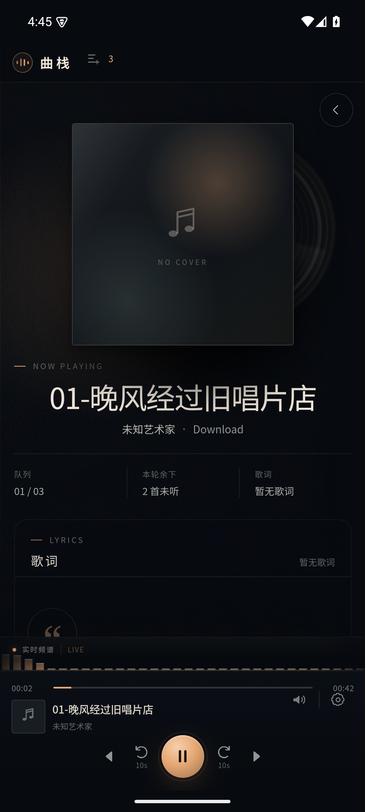
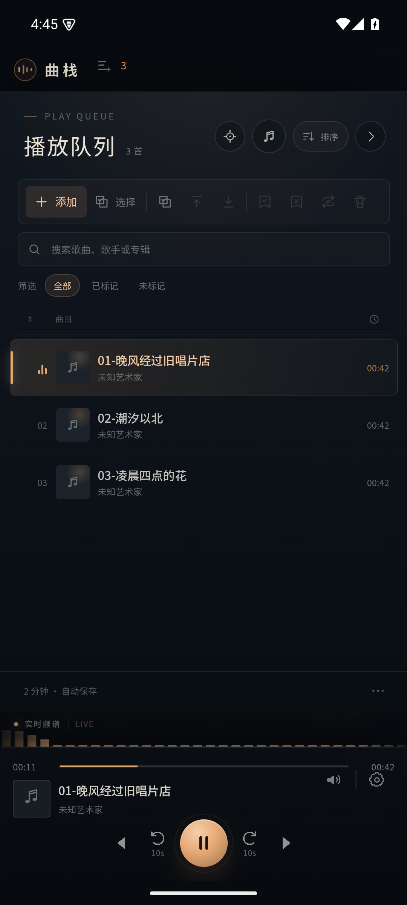
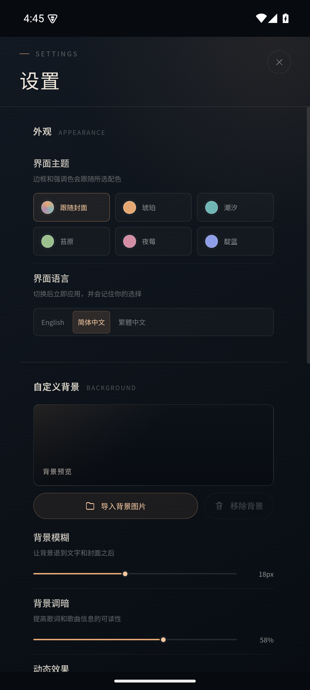
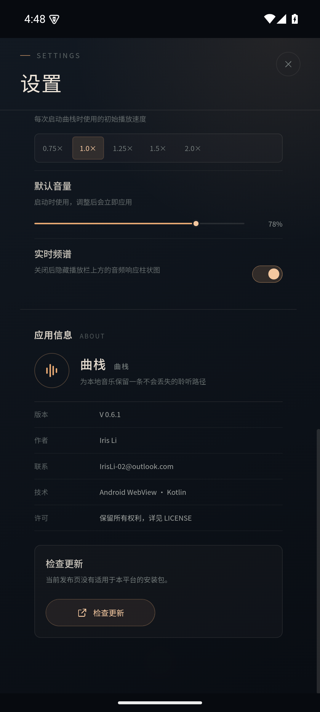

# 曲栈 Android 版

这是曲栈的 Android 移植工程。界面、队列、歌词、主题、三语、搜索筛选、排序、播放模式、倍速和频谱继续复用仓库根目录 `src/` 下的共享实现；Android 外壳使用 Kotlin 和 WebView。

## 界面预览

| 播放界面 | 播放队列 | 设置 |
| --- | --- | --- |
|  |  |  |



## 已适配

- 通过系统文件选择器一次导入多首本地音频，也可以在队列顶部一键扫描系统媒体库。
- 音频不复制到应用私有目录；队列保存 SAF 或 MediaStore 的 `content://` 引用。
  应用只保存队列状态、压缩封面和背景，避免整库复制导致存储翻倍。
- 启动时和删除歌曲后会清理不再引用的封面，并删除旧版遗留的无引用音频副本。
- 队列支持按歌手、歌名、倒序排序，并可随时恢复最初导入顺序。
- 手机端提供独立“选择”模式：进入后点按歌曲即可多选，再使用现有的标记、移动、循环和删除操作。
- 播放失败且文件不可用时询问是否移出队列；错误监听按当前曲目绑定，避免旧错误误报下一首。
- 设置页提供“检查更新”：下载 APK 后校验包名、版本和签名，再调用系统覆盖安装。
- 队列超过 120 首时启用可视区域虚拟渲染；1000 首测试队列只保留约 23 个 DOM 行。
- 支持 MP3、FLAC、M4A/M4B、AAC、WAV、OGG/OPUS、WebM。
- 读取歌曲标题、歌手、专辑、时长和封面；封面最长边压缩到 640px，并按内容哈希去重。
- 读取 ID3v2 USLT 和 Vorbis 注释中的内嵌歌词；如果同时选中同名 `.lrc` 与音频，
  也会优先使用 `.lrc`。
- 本地 HTTP 媒体服务只监听 `127.0.0.1`，使用随机令牌；本地音频通过 SAF /
  MediaStore 引用按 Range 转发，封面和背景只从应用私有目录读取。
- 队列、进度、已听标记、主题、语言和设置持久化到应用私有目录。
- 播放时显示系统媒体通知，可在通知栏暂停、继续、上一首或下一首。
- Android 返回键会先关闭设置、弹窗或队列；没有可关闭的界面时退到后台，音乐继续播放。

## 有意移除的桌面功能

- 桌面歌词悬浮窗及其缩放、透明度、锁定和鼠标穿透设置。
- 最小化、最大化、关闭按钮行为与托盘。
- Windows 文件关联和默认播放器设置。
- 系统级快捷键录制。
- Windows 安装器的语言页、快捷方式、默认播放器选项和安装目录选择。

## 构建

要求：

- Android Studio（推荐）或 JDK 17/21。
- Android SDK Platform 35、Build Tools 35.0.0。
- Android 8.0（API 26）或更高版本的设备。

使用 Android Studio 打开 `android/` 目录，等待 Gradle 同步后运行 `app`。也可以在配置好 `ANDROID_HOME` 后执行：

```powershell
cd android
.\gradlew.bat assembleDebug
```

调试 APK 输出到：

```text
android/app/build/outputs/apk/debug/app-debug.apk
```

正式分发前需要配置自己的签名密钥；仓库不包含签名文件或发布凭据。

Windows 下如果仓库位于含中文的路径，Gradle 构建通过
`android.overridePathCheck=true` 工作；单元测试的 JVM 测试进程仍可能因
非 ASCII 类路径报 `ClassNotFoundException`。遇到这种情况，可从仅含 ASCII
字符的目录联接或副本运行 `testDebugUnitTest`。

## 数据与隐私

- 一键扫描需要 Android 13+ 的“音乐和音频”读取权限；Android 12 及以下使用
  存储读取权限。曲栈只在本机查询 MediaStore，不上传文件或媒体库信息。
- 自动更新需要允许曲栈“安装未知应用”。Android 只会在包名和签名一致时覆盖安装，
  不会与旧版本并存；如果签名不同，系统会拒绝安装且旧数据不会被删除。
- 原始音乐不会被移动或删除；卸载应用只删除队列、压缩封面和背景。系统媒体库条目
  或持久化 SAF 授权被移除后，对应歌曲会显示为不可用。
- 曲栈不上传音频、封面、歌词、队列或播放记录，也不接入在线音乐平台。
- 通知权限只用于显示系统播放控制；不授权时仍可播放，但通知栏可能不显示。
